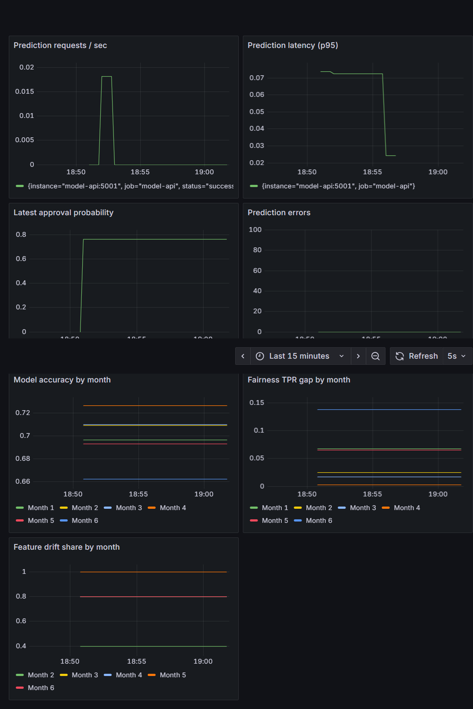
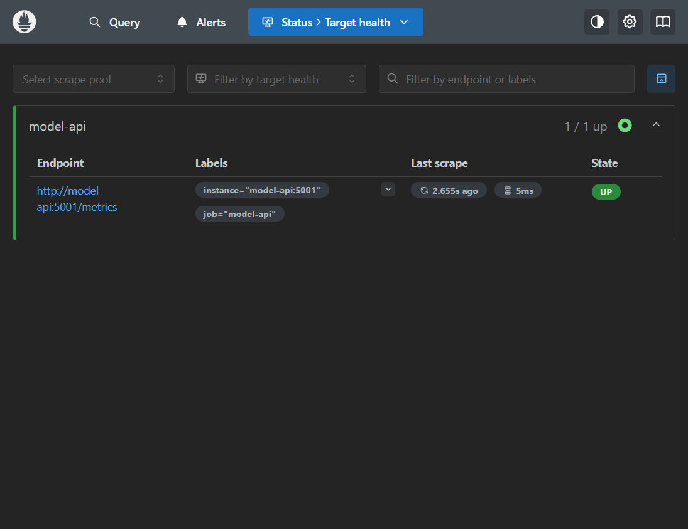

# Model Monitoring Platform — Project Report

## Abstract

This project demonstrates a model-monitoring workflow for a synthetic credit-approval classifier. Across six simulated monthly batches, it tracks feature drift, predictive performance and group true-positive-rate gaps. A Flask service exposes predictions and Prometheus metrics; Prometheus scrapes the service and evaluates model-quality alert rules; Grafana visualizes live service telemetry and batch monitoring results.

## Problem statement and objectives

Deployed models can become less reliable as their inputs and the relationship between inputs and outcomes change. This prototype aims to make those changes visible through repeatable batch evaluation, alert thresholds, service telemetry and operational guidance.

1. Generate six months of synthetic credit-approval data with known changes.
2. Train a baseline classifier using month 1.
3. Compare later-month features against a month-1 reference with Evidently.
4. Measure accuracy, precision, recall, F1 and a group TPR-gap diagnostic.
5. Expose API service metrics to Prometheus and visualize them in Grafana.
6. Configure alerts for accuracy, feature drift and fairness, and document response actions.

## Architecture and implementation

`src_generate_data.py` creates the dataset. `src_train_model.py` trains a scikit-learn pipeline using month 1 and saves `model.joblib`. `monitor.py` evaluates held-out month-1 records and each later batch, writes `reports/monthly_metrics.csv`, and creates per-month Evidently HTML and JSON reports. Gender is excluded from model features and used only for the post-hoc fairness calculation.

The Flask application in `app.py` serves `POST /predict`, `GET /health` and `GET /metrics`. Prometheus scrapes `/metrics` on the Compose network every five seconds. Month-labeled gauges expose all available batch results to Grafana, while dedicated latest-month gauges prevent historical breaches from incorrectly triggering active alerts. Grafana provisions its Prometheus data source and the dashboard at container startup.

```text
Synthetic monthly data --> train on month 1 --> model.joblib
             |
             +--> offline evaluation --> monthly_metrics.csv + Evidently reports
                                                |
Client --> Flask API (/predict, /metrics) --> Prometheus --> Grafana (7 panels)
                                                |
                                      3 model-quality alert rules
```

## Evaluation results

Values below are from the checked-in `reports/monthly_metrics.csv`. Drift is the fraction of features flagged by Evidently; month 1 is the reference and has no drift comparison.

| Month | Accuracy | Precision | Recall | F1 | Fairness TPR gap | Drift share |
|---|---:|---:|---:|---:|---:|---:|
| 1 (held-out baseline) | 0.6967 | 0.7151 | 0.7778 | 0.7451 | 0.0676 | — |
| 2 | 0.7092 | 0.7334 | 0.7966 | 0.7637 | 0.0250 | 0.4000 |
| 3 | 0.7100 | 0.7418 | 0.7714 | 0.7563 | 0.0168 | 0.8000 |
| 4 | 0.7267 | 0.7480 | 0.7954 | 0.7709 | 0.0025 | 0.8000 |
| 5 | 0.6933 | 0.6680 | 0.8003 | 0.7282 | 0.0649 | 1.0000 |
| 6 | 0.6625 | 0.6128 | 0.7997 | 0.6939 | 0.1375 | 0.8000 |

Accuracy first falls below 0.70 in month 5, and the fairness gap first exceeds 0.12 in month 6. The feature-drift rule is configured for any positive drift share; the checked-in results show a positive share in month 2, before the intentional population shift introduced from month 3. This early finding is retained rather than misrepresented as a later detection.

## Dashboard and alert configuration

The provisioned Grafana dashboard has seven panels:

1. Prediction requests per second
2. Prediction latency (p95)
3. Latest approval probability
4. Prediction errors
5. Model accuracy by month
6. Fairness TPR gap by month
7. Feature drift share by month

Prometheus evaluates these rules every five seconds with a one-minute pending period:

| Alert | Condition | Severity |
|---|---|---|
| `ModelAccuracyDegraded` | Latest monthly accuracy < 0.70 | Critical |
| `FeatureDriftDetected` | Latest monthly drift share > 0 | Warning |
| `FairnessViolation` | Latest monthly absolute group TPR gap > 0.12 | Warning |

The local Compose deployment displays active alerts in Prometheus but does not configure Alertmanager or an external notification receiver. API error and latency metrics are dashboard signals, not alert rules.

## Detection timing

The simulation introduces additional concept noise in month 4 and a group-specific outcome shift in month 5. Accuracy crosses its threshold in month 5 (one monthly batch later); the fairness gap crosses its threshold in month 6 (also one batch later). Feature drift is flagged in month 2, earlier than the intentional population shift from month 3, consistent with possible sampling variation. These are batch-level observations, not real-time detection guarantees.

## Screenshots and reproducibility

The dashboard, datasource and Prometheus rules are provisioned from the repository. The following captures were taken from the running Compose stack after sending a prediction; the scrape target is healthy and the Grafana view contains all seven configured panels.





Setup and verification steps are in [README.md](./README.md); operational severity and response actions are in [ALERT_RUNBOOK.md](./ALERT_RUNBOOK.md).

## Limitations

The dataset and planted changes are synthetic. The API does not calculate fresh batch metrics; it loads the latest results generated offline. The TPR gap is one diagnostic and does not establish legal or ethical fairness. Drift alone is not proof of performance loss, and model-quality metrics require labels. A one-minute Prometheus hold prevents momentary rule changes from immediately firing but does not convert monthly batch evaluation into continuous monitoring.

## Conclusion

The prototype connects offline model evaluation with live service observability. Its measured results show why drift, accuracy and fairness should be tracked separately and why an alert should trigger investigation rather than automatic retraining.
