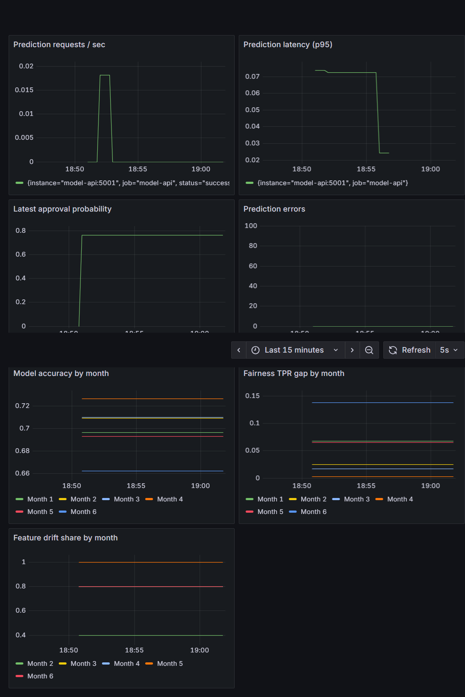
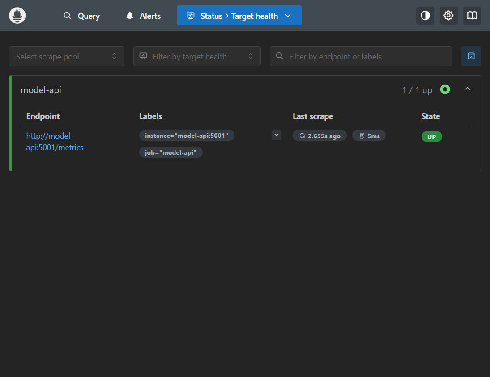
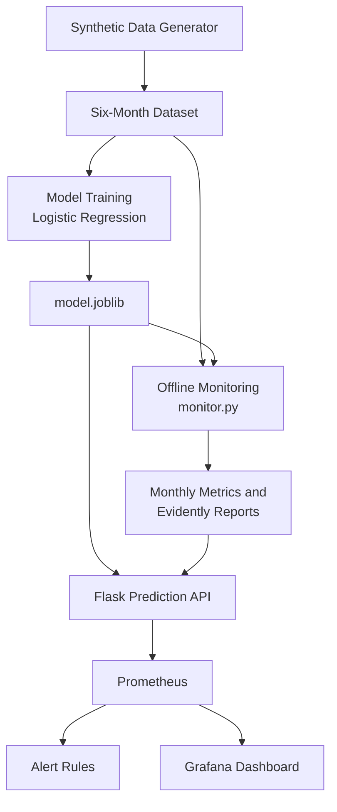

# Model Monitoring Platform

A reproducible course project that monitors a binary credit-approval classifier over six simulated months. It combines offline data-drift, accuracy and fairness analysis with a Flask prediction API, Prometheus metrics, Grafana dashboards and Prometheus alert rules.

## Features

- 7,200 synthetic records, with month 1 used to train the model and as the drift reference.
- Planted population drift, increasing concept noise and a group-specific outcome shift.
- Flask prediction endpoint and Prometheus request, latency, error and prediction metrics.
- Monthly accuracy, precision, recall, F1, fairness TPR gaps and Evidently reports.
- Grafana dashboard provisioned at startup with seven panels.
- Prometheus rules for accuracy degradation, feature drift and fairness violations.
- Operational guidance in [ALERT_RUNBOOK.md](./ALERT_RUNBOOK.md) and measured results in [PROJECT_REPORT.md](./PROJECT_REPORT.md).

## Requirements

- Git
- Docker Desktop with Docker Compose v2 (the recommended path; no local Python install required)
- Python 3.11 for running the generation, training and monitoring scripts outside Docker

## Quick start from a fresh clone

```bash
git clone https://github.com/codeninja-1234/Model-Monitoring-Platform.git
cd Model-Monitoring-Platform
docker compose up --build -d
docker compose ps
```

The model, monthly metrics, data and Grafana/Prometheus configuration are included in the repository. The API image installs its dependencies and loads the checked-in model and monthly results.

The default host ports are 5001 (API), 9090 (Prometheus) and 3000 (Grafana). If one is already in use, set `MODEL_API_PORT`, `PROMETHEUS_PORT` or `GRAFANA_PORT` before starting Compose; for example, in PowerShell:

```powershell
$env:MODEL_API_PORT = "5002"
$env:PROMETHEUS_PORT = "9091"
$env:GRAFANA_PORT = "3001"
docker compose up --build -d
```

## 3b. Analyse and validate the monitoring results
```bash
python analyze_results.py     # validation, fairness table, detection delays, charts
python -m pytest -q           # unit and sanity tests
```
Creates `reports/figures/*.png`, `reports/detection_analysis.csv`, `reports/fairness_detail.csv`,
`reports/validation_checks.csv`, `reports/monitoring_summary.json`. Findings are written up in `MONITORING_ANALYSIS.md`.

## 4. Run the prediction API locally
In a terminal:
```bash
python app.py
In macOS/Linux, prefix the start command with the desired values, for example `PROMETHEUS_PORT=9091 GRAFANA_PORT=3001 docker compose up --build -d`.

Open:

- Grafana: http://localhost:3000 (demo login: `admin` / `admin`)
- Prometheus targets: http://localhost:9090/targets
- Prometheus active alerts: http://localhost:9090/alerts
- API health: http://localhost:5001/health
- API metrics: http://localhost:5001/metrics

Send a prediction request to create live request, latency and approval-probability samples.

**PowerShell**
```powershell
Invoke-RestMethod -Uri http://localhost:5001/predict -Method Post `
  -ContentType "application/json" `
  -Body '{"age":35,"income":65000,"debt_ratio":0.25,"credit_history":8,"region":"South"}'
```

**macOS/Linux**
```bash
curl -X POST http://localhost:5001/predict \
  -H "Content-Type: application/json" \
  -d '{"age":35,"income":65000,"debt_ratio":0.25,"credit_history":8,"region":"South"}'
```
Metrics: http://localhost:5001/metrics

Prometheus scrapes the Flask API every five seconds. The dashboard is automatically provisioned in the **Model Monitoring** folder and contains:

1. Prediction requests per second
2. Prediction latency (p95)
3. Latest approval probability
4. Prediction errors
5. Model accuracy by month
6. Fairness TPR gap by month
7. Feature drift share by month

The three model-quality alert rules are evaluated every five seconds and fire after a condition remains true for one minute. They are visible on Prometheus `/alerts`; no notification receiver or Alertmanager is configured in this local demo. API error and latency metrics are visualized but do not have alert rules.

Stop the stack with:
```bash
docker compose down
```

## Reproduce the offline experiment (optional)

Use Python 3.11, create a virtual environment, then install dependencies:

```bash
python -m venv .venv
```
Open:
- Grafana: http://localhost:3000 (login: admin / admin)
- Prometheus: http://localhost:9090
- Model API: http://localhost:5001/health

Activate it with `.\.venv\Scripts\Activate.ps1` in PowerShell or `source .venv/bin/activate` on macOS/Linux. Then run:

```bash
python -m pip install --upgrade pip
python -m pip install -r requirements.txt
python src_generate_data.py
python src_train_model.py
python monitor.py
```

The scripts create the six-month dataset, train on month 1, and write monthly results and Evidently HTML/JSON reports to `reports/`. Run the analysis before rebuilding the Compose stack if you want the API to load newly generated metrics:

```bash
docker compose up --build -d
```

## Architecture

```text
data/six_months.csv
      |                             data/reference.csv
      |                                      |
      +--> month 1 --> src_train_model.py    +--> monitor.py
      |                  |                         |
      |              model.joblib                 +--> monthly_metrics.csv
      |                                            +--> drift_month_*.html/json
      +--> months 1-6 --> monitor.py
                                                     |
Client --> Flask API (/predict, /metrics) <----------+
                     |                         (loads monthly metrics)
                     v
                 Prometheus ------------------> Grafana
                 scrape + rules                 7-panel dashboard
```

The Flask process exposes live service metrics and the latest monthly evaluation gauges. Month-labeled gauges retain the six-month history for Grafana; separate latest-month gauges ensure alert rules evaluate only the most recent batch, rather than firing because an old month breached a threshold. The offline simulation is not an online model-quality evaluation.

## Screenshots and results

The verified dashboard and scrape target are shown below. The checked-in monthly metrics and drift reports are summarized in [PROJECT_REPORT.md](./PROJECT_REPORT.md).





## Interpretation and limitations

This is a synthetic demonstration, not evidence that a real production model was monitored. The fairness value is the absolute difference in group true-positive rates (F vs M), a diagnostic rather than a complete fairness assessment. Drift does not itself prove model degradation, and reliable performance evaluation requires labels. Prometheus evaluates the checked-in latest monthly batch; it does not continuously compute new offline model-quality results.

## References

- [Evidently documentation](https://docs.evidentlyai.com/)
- [Prometheus Python client](https://prometheus.github.io/client_python/)
- [Prometheus documentation](https://prometheus.io/docs/)
- [Grafana documentation](https://grafana.com/docs/grafana/latest/)

## System Architecture


